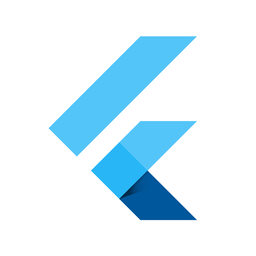
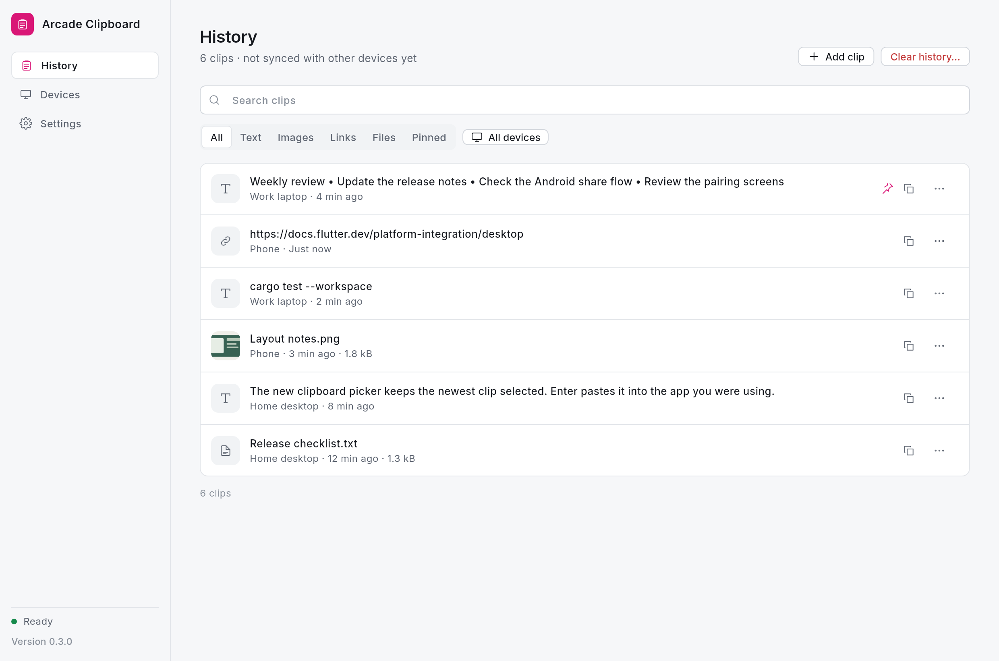

<p align="center">
  
</p>

<h1 align="center">Arcade Clipboard</h1>

<p align="center">An encrypted copy history, synced across your own devices.</p>

<p align="center">
  <a href="https://github.com/qa-p1/Arcade-clipboard/releases/latest"></a>
  <a href="https://github.com/qa-p1/Arcade-clipboard/actions/workflows/ci.yml"></a>
</p>

---

Arcade Clipboard keeps an encrypted copy history in sync across your own devices. Copy on one device, then open the picker on another to find and paste that clip. There is no account or cloud clipboard server: devices pair with a QR code and find each other on the local network, or through an optional relay you run.

Desktop builds run on **Linux** (x64; Hyprland, X11 and other Wayland compositors), **Windows** (x64) and **macOS** (universal: Apple Silicon and Intel). An unsigned **iPhone/iPad** IPA is available to sign yourself; **Android** builds exist but have not been tested on a device. Hyprland is tested end to end on real hardware; Windows and macOS are CI builds, not run interactively.

<p align="center"></p>

## Download and install

Download the file for your system from [Releases](https://github.com/qa-p1/Arcade-clipboard/releases). Or install it from **[Arcade Tools](https://github.com/qa-p1/Arcade-tools) → Apps**, which can also update and remove it.

| Platform | File | How to install |
|---|---|---|
| Linux x64 | `Arcade-Clipboard-<version>-x86_64.AppImage` | Make it executable and run it. The first run asks **Install Arcade Clipboard?** and installs to `~/Applications/Arcade`, adds a menu entry, an `arcade-clipboard` command and an optional start at login. **Just run it once** leaves the download in place. |
| Linux x64 (transition release only) | `Arcade-Clipboard_<version>_linux_x64.tar.gz` | Extract it and run `bash install-linux.sh`; it copies the bundle into `~/.local/share/arcade-clipboard` and adds a per-user launcher entry. Planned to be removed after one release. |
| Windows x64 | `Arcade-Clipboard_<version>_windows_x64-setup.exe` | Run Setup. Installs for your user without admin, adds a Start menu entry, optional desktop shortcut and start at login, and puts `arcade-clipboard` on PATH. |
| macOS (universal) | `Arcade-Clipboard_<version>_macos_universal.dmg` | Open the dmg and drag Arcade Clipboard to Applications. Run from the dmg or Downloads, it offers to move itself to Applications. |
| iPhone, iPad | unsigned IPA (CI artifact) | Sign and install it with your own signing tool. See [iPhone setup](docs/ios.md). |

- Scripted Linux install: `--install --silent --no-launch`. `--repair` restores integration. Scripted Windows install: `/VERYSILENT /SUPPRESSMSGBOXES /NORESTART /CURRENTUSER`.
- Linux needs GTK 3 and an unlocked Secret Service keyring (GNOME Keyring, KWallet) for the device identity. Wayland capture needs `wl-clipboard` 2.2 or newer; X11 paste needs `xdotool`.
- Builds are unsigned. On Windows, SmartScreen may warn: choose **More info → Run anyway**. On macOS the app is not notarized: right-click it and choose **Open** the first time.
- If FUSE is missing on Linux, run the AppImage with `--appimage-extract-and-run`.

Every desktop release includes `arcade-release.json` and `SHA256SUMS.txt`. See [Getting started](docs/user/getting-started.md) and [release packages](docs/releases.md).

## Features

- **History across devices:** plain text, links, HTML and RTF, PNG and JPEG images, and files. A text clip is limited to 32 KiB and a clip to 16 MiB; folders are not supported.
- **Encrypted per device:** each device keeps its own encrypted history. Copying a clip again moves it to the top instead of duplicating it. Pin and search clips from the picker.
- **Catch-up sync:** a device that was offline catches up when it reconnects, while the clips are still in history.
- **Paste from the picker:** on supported desktops Clipboard returns focus to the app you were using and pastes; otherwise it copies the clip for you to paste.
- **Received clips stay in history** until you choose them; the system clipboard is not replaced.
- **Private mode** pauses capture and denies sending clip content to other apps or devices, without deleting history. Sources marked sensitive (such as password managers) are skipped.
- **Pairing:** QR code plus a six-digit verification number. The device that created the mesh approves and removes members. An optional relay forwards traffic between online devices and does not store clips.
- **Phones:** the iOS share extension and clipboard keyboard; Android includes a share target and keyboard (not run on a device).

More in [Features](docs/user/features.md).

## Works with other Arcade apps

Clipboard works on its own. On Linux, Windows and macOS it connects to other installed Arcade apps automatically over Arcade Link, **without needing Arcade Tools**. Turn this on or off with **Connect with other Arcade apps** in Clipboard's Connected apps settings, with a switch per app. A peer action appears only when it can handle the selected clip.

| App | What it adds to Clipboard or receives from it |
|---|---|
| Arcade Box | Format JSON, Clean text and Convert to PNG. Box results can become new clips. Oversized images can be compressed through Box (opt-in). |
| Arcade Lens | Analyze an image, extract text or pin an image. Lens results can become new clips. |
| Arcade Look | Quick Look a supported image or file. |
| Arcade Shelf | Add a clip to Shelf: text, links, rich text, images and files. |
| Arcade Find | Find can send selected results to your devices through Clipboard. |
| Arcade Wheel | Clipboard exposes **Send to my devices** for compatible content. |
| Arcade Tools | Install, update or remove Clipboard in its **Apps** tab. |

Other apps can send content to your devices with **Send to my devices**, or open the picker and ask you to choose a clip; the chosen clip goes back to the requesting app instead of being pasted. Nothing exposes your history unless you choose a clip. Phones are not Link participants, but content sent to your devices arrives in their history like any other clip.

When Arcade Tools is running, its tray icon hosts Clipboard's menu, including **Private mode**. When Tools quits or stops hosting, Clipboard's own icon returns. With "Connect with other Arcade apps" off, Clipboard always shows its own icon.

See [how Clipboard works with other Arcade apps](docs/user/with-other-apps.md) and the [Arcade Link reference](docs/arcade-link.md).

## Usage

1. On the first device choose **Create a mesh**, then **Devices → Add device** to show a QR code and pairing code (valid for two minutes).
2. On the second device choose **Join an existing mesh** and scan the code or type it.
3. Compare the six-digit verification number on both devices and approve on each.

Open the picker with **Ctrl+Shift+Space** on Linux, **Ctrl+Alt+V** on Windows, **Cmd+Shift+V** on macOS. Type to search, move with the arrow keys and press **Enter** to paste. On Wayland compositors without in-app shortcut support, bind `arcade-clipboard --overlay` yourself. See the [shortcut reference](docs/user/shortcuts.md).

Clipboard stays in the background so it can capture copies and receive clips. Its tray icon opens Settings; choose **Quit Arcade Clipboard** from the tray menu to stop it.

### Command line

The installed desktop command is `arcade-clipboard`. The app bundle also contains `clipboard`, a generic name that can conflict with another command.

| Option | Effect |
|---|---|
| `--background` | Start without showing the window. Used by **Launch at login**. |
| `--overlay` | Open the picker in the running instance, or start the app and open it. |
| `--quit` | Quit the running instance |
| `--version` | Print the version |
| `--install [--silent] [--no-launch] [--channel C]` | Install this AppImage / macOS app |
| `--uninstall [--silent] [--remove-data]` | Remove the installation; data is kept unless `--remove-data` |
| `--repair` | Restore the launcher, command and login entries |
| `--integration-status` | Print the integration as JSON |
| `--arcade-manifest` | Print the Arcade Link manifest |

| Environment variable | Effect |
|---|---|
| `ARCADE_DEBUG=1` | Print capture, picker, paste and connection events to stderr. Clipboard contents are never logged. |
| `ARCADE_DATA_DIR` | Use a different profile directory; also allows a second instance. |
| `ARCADE_RELAY_URL` | Default relay address for new profiles. **Settings → Remote relay** overrides it. |

## Settings and data

History lives in an encrypted store in the app's per-user data directory (`ARCADE_DATA_DIR` selects another profile). On Linux, the device identity is kept in the Secret Service keyring; the app refuses to start a profile whose key is missing rather than silently creating a new identity.

Arcade Tools can export and import Clipboard's paused state, history retention and maximum items. Import keeps a backup of the previous values. **Never exported:** history, keys and devices never leave the encrypted store.

## Uninstall

- **Linux:** run `arcade-clipboard --uninstall`, use the launcher's **Uninstall** action, or remove Clipboard in Arcade Tools.
- **Windows:** **Settings → Apps** (Apps & features), or Arcade Tools.
- **macOS:** `--uninstall` removes the installation recorded in its receipt, or remove Clipboard in Arcade Tools.

Your encrypted data is kept unless you add `--remove-data`.

## Platform notes

| | Automatic capture | Global shortcut | Paste into previous app | Background sync | Tested on |
| --- | --- | --- | --- | --- | --- |
| Linux, Hyprland | Yes | Yes | Yes | Yes | Real hardware, end to end |
| Linux, X11 | Yes | Yes | Yes, with `xdotool` | Yes | Capture, picker and quit tested in headless Xvfb; native paste not run |
| Linux, other Wayland | With data-control (not GNOME) | Bind `clipboard --overlay` | No, copies for Ctrl+V | Yes | Build only |
| iPhone, iPad | No (iOS does not allow it) | Share sheet and keyboard | Keyboard inserts text | Only while the app is open | Not yet run on a device |
| Android | No | Share target and keyboard | Keyboard inserts text | While the app runs | Build only |
| Windows | Yes | Yes | Yes | Yes | CI build (desktop app and Rust core tests); not run interactively |
| macOS | Yes | Yes | Yes, needs Accessibility | Yes | CI build (desktop app and Rust core tests); not run interactively |

See [Platforms](docs/platforms.md) and the [Linux guide](docs/linux.md).

## Build from source

The desktop app uses Flutter with a Rust core. The Rust core also runs the relay service; mobile builds provide share targets and clipboard keyboards.

| Tool | Version |
| --- | --- |
| Flutter | 3.47.2 (Dart 3.13) |
| Rust | 1.98.1 |
| flutter_rust_bridge | 2.13.0 |

Linux prerequisites (Debian and Ubuntu):

```bash
sudo apt-get install clang cmake ninja-build pkg-config \
  libgtk-3-dev libkeybinder-3.0-dev libdbus-1-dev libsecret-1-dev
```

```bash
bash scripts/dev.sh desktop        # run the Linux app in debug mode
bash scripts/dev.sh build-linux    # release bundle and transition tarball
bash scripts/dev.sh test           # Rust workspace tests and Flutter tests
bash scripts/dev.sh check          # rustfmt, Clippy and flutter analyze
```

See the [development guide](docs/development.md) for all commands, CI and debugging.

## Documentation

- [User guide](docs/user/): [getting started](docs/user/getting-started.md), [features](docs/user/features.md), [shortcuts](docs/user/shortcuts.md), [FAQ](docs/user/faq.md), [troubleshooting](docs/user/troubleshooting.md)
- [Development guide](docs/development.md): build, tests, CI, debugging
- [Linux guide](docs/linux.md): requirements, desktop integration and troubleshooting
- [Architecture](docs/architecture.md): app, Rust core, native code, capture and sync
- [Protocol](docs/protocol.md): pairing, wire format, item kinds and convergence
- [Security](docs/security.md): threat model, key storage and limits
- [Arcade Link](docs/arcade-link.md): desktop actions, peer behavior and the optional Arcade Tools hub
- [Relay deployment](docs/relay-deployment.md): run a relay with Docker, Caddy or Cloudflare
- [Platforms](docs/platforms.md) and [iPhone setup](docs/ios.md)
- [Release packages](docs/releases.md)
- [Status](docs/STATUS.md): implementation and verification record
- [Changelog](CHANGELOG.md)

## License

[MIT](LICENSE)

---

<p align="center">
  Part of the <b>Arcade</b> suite:
  <a href="https://github.com/qa-p1/Arcade-Find">Find</a> ·
  <a href="https://github.com/qa-p1/Arcade-lens">Lens</a> ·
  <a href="https://github.com/qa-p1/Arcade-look">Look</a> ·
  <a href="https://github.com/qa-p1/Arcade-box">Box</a> ·
  <a href="https://github.com/qa-p1/Arcade-clipboard">Clipboard</a> ·
  <a href="https://github.com/qa-p1/Arcade-Shelf">Shelf</a> ·
  <a href="https://github.com/qa-p1/Arcade-wheel">Wheel</a> ·
  <a href="https://github.com/qa-p1/Arcade-tools">Tools</a> ·
  <a href="https://github.com/qa-p1/Arcade-catalog">Docs</a>
</p>
